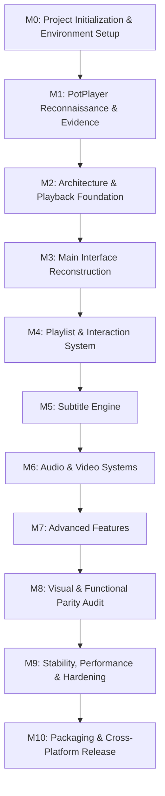

# ROADMAP.md — JonakiPlayer Development Roadmap

This roadmap governs the milestone deliverables for the **JonakiPlayer** project. It is kept synchronized with `.gsd/ROADMAP.md`.

---

## Milestone Overview

---

## Detailed Milestones

### M0 — Project Initialization & Environment Setup
- **Objective:** Establish the development environment, verify tooling (C++20, CMake, Ninja, REA, GSD), initialize the repository, create persistent memory, and configure the project structure.
- **Tasks:**
  - [x] Environment reconnaissance (OS, CPU, available tools).
  - [x] Install & verify Node.js LTS and Git.
  - [x] Install & configure REA framework with Antigravity MCP server registration.
  - [x] Install & validate GSD framework (workflows, skills, subagents, rules).
  - [x] Locate and inspect reference PotPlayer installation and assets.
  - [ ] Configure C++20 build toolchain (MSYS2 MinGW-w64 / Qt6 / CMake).
  - [x] Initialize Git repository, `.gitignore`, directory structure.
  - [x] Create project memory and foundation documentation.
- **Status:** **In Progress**
- **Target Completion:** 2026-11-09

---

### M1 — PotPlayer Reconnaissance & Parity Matrix
- **Objective:** Systematically analyze the reference PotPlayer installation using REA and automated scripts; map all menus, command IDs, skins, shortcuts, and playback configurations into an evidence register and feature parity matrix.
- **Tasks:**
  - [ ] Extract and catalog all string tables and command IDs from `Language/English.ini`.
  - [ ] Deconstruct `Default.dsf` skin layout, XML directives, and coordinate spritesheets.
  - [ ] Inspect `SimpleMenu.xml` and main context menus.
  - [ ] Audit PotPlayer default keyboard shortcuts and mouse button bindings.
  - [ ] Compile `docs/feature-parity/feature-matrix.md` with baseline parity checklist.
- **Status:** **Pending**
- **Dependencies:** M0

---

### M2 — Architecture & Playback Foundation
- **Objective:** Implement the application skeleton, Qt 6 event loop, CMake project build, logging subsystem, settings persistence, and abstract playback engine integrated with `libmpv`.
- **Tasks:**
  - [ ] Root `CMakeLists.txt` configuring C++20, Qt6, and libmpv.
  - [ ] Application entry point (`src/application/main.cpp`) and single-instance guard.
  - [ ] Core logging and configuration manager (`src/settings/SettingsManager.cpp`).
  - [ ] Abstract playback interface `IPlaybackEngine` and `MpvPlaybackEngine` implementation.
  - [ ] Basic video render widget rendering frames via `libmpv`.
  - [ ] Integration test verifying media loading, playback start, pause, seek, and stop.
- **Status:** **Pending**
- **Dependencies:** M1

---

### M3 — Main Interface Reconstruction
- **Objective:** Implement the PotPlayer visual layout: custom frameless window, title bar with system buttons, bottom control bar, seek slider, time indicator, volume slider, and context menus.
- **Tasks:**
  - [ ] Custom frameless window with resize handles, border snapping, and DPI scaling.
  - [ ] PotPlayer skin rendering subsystem (`src/ui/SkinRenderer.cpp`).
  - [ ] Bottom playback control bar with Play, Pause, Stop, Prev, Next buttons.
  - [ ] Timeline seekbar with hover preview, buffered range, and chapter markers.
  - [ ] Volume slider and mute toggle.
  - [ ] Main right-click context menu faithful to PotPlayer's menu hierarchy.
  - [ ] Fullscreen toggle and auto-hiding control bar behavior.
- **Status:** **Pending**
- **Dependencies:** M2

---

### M4 — Playlist & Interaction System
- **Objective:** Implement the collapsible playlist panel, media queue, drag-and-drop loading, keyboard shortcut engine, and mouse gesture handling.
- **Tasks:**
  - [ ] Playlist drawer dockable to the right side of the main window.
  - [ ] Playlist item management (add files, add folders, reorder, delete, clear).
  - [ ] Drag-and-drop support for single files, multiple files, and directories.
  - [ ] Shuffle, repeat (track / playlist), and auto-next playback logic.
  - [ ] Keyboard shortcut dispatcher matching PotPlayer defaults (Space=Play/Pause, Left/Right=Seek, etc.).
  - [ ] Mouse interaction mapper (Left click=Pause, Double click=Fullscreen, Wheel=Volume).
  - [ ] Playback history persistence and resume-from-last-position prompt.
- **Status:** **Pending**
- **Dependencies:** M3

---

### M5 — Subtitle Engine
- **Objective:** Implement comprehensive subtitle display, synchronization, styling, and multi-track management.
- **Tasks:**
  - [ ] Internal subtitle track detection and selection.
  - [ ] External subtitle auto-loading (`.srt`, `.ass`, `.ssa`, `.vtt`).
  - [ ] Subtitle delay and synchronization adjustments (`<` and `>` hotkeys).
  - [ ] Subtitle styling configuration (font, size, colors, outline, shadow, vertical position).
  - [ ] Secondary subtitle display support (simultaneous two-language subtitles).
- **Status:** **Pending**
- **Dependencies:** M4

---

### M6 — Audio & Video Systems
- **Objective:** Implement advanced audio and video processing controls, filters, and rendering adjustments.
- **Tasks:**
  - [ ] Audio stream selection, audio device routing, and volume normalization.
  - [ ] 10-band graphic equalizer with presets.
  - [ ] Audio delay adjustment (`Shift + <` and `Shift + >`).
  - [ ] Video aspect ratio controls (Default, 16:9, 4:3, Fill window, Stretch).
  - [ ] Video color adjustments (Brightness, Contrast, Saturation, Hue).
  - [ ] Deinterlacing filters and video rotation (90°, 180°, 270°, flip).
  - [ ] Hardware decoding configuration (DXVA2, D3D11VA, NVDEC, VAAPI).
- **Status:** **Pending**
- **Dependencies:** M5

---

### M7 — Advanced Features
- **Objective:** Implement advanced PotPlayer features including streaming URL playback, frame capture, bookmarking, and media info inspection.
- **Tasks:**
  - [ ] Stream playback from network URLs (HLS, DASH, HTTP/HTTPS, YouTube via yt-dlp).
  - [ ] Frame capture (snapshot current frame to PNG/JPG, sequential capture).
  - [ ] Media information dialog (detailed codec, bitrate, resolution, container metadata).
  - [ ] A-B repeat playback loop controls (`[` and `]`).
  - [ ] Playback speed adjustment (0.2x to 3.0x with pitch correction).
- **Status:** **Pending**
- **Dependencies:** M6

---

### M8 — Visual & Functional Parity Audit
- **Objective:** Comprehensive audit against the reference PotPlayer installation; verify UI layout, menus, hotkeys, and behavioral parity.
- **Tasks:**
  - [ ] Automated visual regression testing (side-by-side screenshot comparisons).
  - [ ] Feature parity checklist validation across all 16 major categories.
  - [ ] Parity gap resolution and UI polish.
  - [ ] Linux parity verification on Ubuntu / KDE / GNOME.
- **Status:** **Pending**
- **Dependencies:** M7

---

### M9 — Stability, Performance & Hardening
- **Objective:** Profile resource consumption, memory leaks, long-duration playback stability, and stress-test media formats.
- **Tasks:**
  - [ ] Idle and active CPU/RAM profiling.
  - [ ] 24-hour continuous playback stress test.
  - [ ] Corrupted and edge-case media file handling.
  - [ ] Memory leak detection (AddressSanitizer / Valgrind / DrMemory).
- **Status:** **Pending**
- **Dependencies:** M8

---

### M10 — Packaging & Cross-Platform Release
- **Objective:** Build and package production releases for Windows and Linux with automated release pipelines.
- **Tasks:**
  - [ ] Windows NSIS installer and standalone portable ZIP distribution.
  - [ ] Linux AppImage and distribution packages.
  - [ ] User guide and release notes publication.
- **Status:** **Pending**
- **Dependencies:** M9
