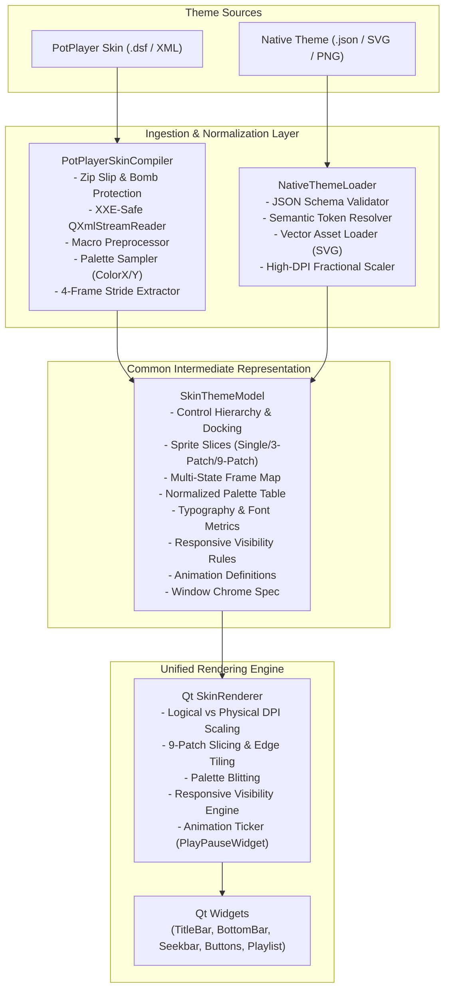

# Milestone M8: Skin Engine Fidelity & Unified Theme Architecture

> **Author:** JonakiPlayer Architecture Team  
> **Date:** 2026-11-12  
> **Status:** APPROVED ARCHITECTURAL SPECIFICATION  
> **Target:** Common Intermediate Representation (IR), Clean-Room Theme Engine, and Visual Parity Subsystem  

---

## 1. Executive Summary & Goals

The mission of Milestone M8 is to achieve complete visual, geometric, and dynamic aesthetic fidelity with Daum/Kakao PotPlayer while establishing an open, extensible, and clean-room theme subsystem.

To achieve this without duplicating rendering engines or compromising cross-platform maintainability, M8 introduces a **Common Intermediate Representation (IR)** (`SkinThemeModel`). Both legacy PotPlayer skin archives (`.dsf` / XML) and modern native JonakiPlayer themes (`.json` / SVG) compile into this shared in-memory model. A single, unified `SkinRenderer` consumes the normalized IR and paints the UI via Qt 6 Painter.



---

## 2. Common Intermediate Representation (SkinThemeModel)

The `SkinThemeModel` is completely platform-neutral and decoupled from raw file formats. It consists of eight strictly separated modules:

### 2.1 Layout & Control Definitions (`ControlDefinition`)
Describes the hierarchy, layout mode, and structural geometry of UI elements:
```cpp
enum class ControlType {
    Container,
    Button,
    Slider,
    Label,
    Image,
    Spacer,
    Visualizer
};

enum class DockAlignment {
    Left,
    Right,
    Top,
    Bottom,
    Client,
    Floating
};

struct ControlDefinition {
    std::string id;
    std::string commandId;
    ControlType type{ControlType::Container};
    DockAlignment dock{DockAlignment::Left};
    
    int width{-1};          // -1 = auto / stretch
    int height{-1};         // -1 = auto / stretch
    int leftMargin{0};
    int rightMargin{0};
    int topOffset{0};
    
    std::string tooltipKey;
    bool isCheckable{false};
    bool autoSize{false};
    
    std::vector<std::string> childControlIds;
};
```

### 2.2 Asset References & Sprite Slices (`SpriteSlice`)
Manages textures, texture slices, and multi-patch borders:
```cpp
enum class PatchMode {
    SingleSlice,            // Exact 1:1 blit
    ThreePatchHorizontal,   // Fixed left cap, stretched center, fixed right cap
    ThreePatchVertical,     // Fixed top cap, stretched center, fixed bottom cap
    NinePatch               // 4 fixed corners, 4 stretched edges, 1 stretched center
};

struct Margins {
    int left{0};
    int top{0};
    int right{0};
    int bottom{0};
};

struct SpriteSlice {
    std::string assetId;    // e.g. "Main.png", "TouchMain.png", "theme.svg"
    QRect sourceRect;       // Pixel coordinates in atlas
    PatchMode patchMode{PatchMode::SingleSlice};
    Margins sliceMargins;   // Margins for 3-patch or 9-patch borders
    bool alphaMode{true};
};
```

### 2.3 Interaction States & Multi-State Frames
Decouples button state transitions from atlas coordinate math:
```cpp
enum class InteractionState {
    Normal,
    Hover,
    Pressed,
    Disabled,
    CheckedNormal,
    CheckedHover,
    CheckedPressed
};

struct StateFrameMap {
    std::unordered_map<InteractionState, SpriteSlice> states;
};
```
*PotPlayer Normalization Rule:* When parsing `<Button ImageLeft='x' ImageTop='y' ImageWidth='w' ImageHeight='h'>`, the compiler automatically constructs `Normal=(x, y)`, `Hover=(x+w, y)`, `Pressed=(x+2w, y)`, `Disabled=(x+3w, y)` into `StateFrameMap`.

### 2.4 Colors & Palette System (`PaletteDefinition`)
Decouples hardcoded colors, theme tokens, and dynamic bitmap palette sampling:
```cpp
enum class ColorRole {
    WindowBackground,
    TitleBarText,
    TimeElapsedText,
    TimeTotalText,
    AccentLive,
    SeekbarTrack,
    SeekbarProgress,
    VolumeSliderTrack,
    BorderHighlight
};

struct PaletteDefinition {
    // Direct RGBA colors
    std::unordered_map<ColorRole, QColor> directColors;
    
    // PotPlayer dynamic atlas sample points (ColorX, ColorY)
    std::unordered_map<ColorRole, QPoint> sampledPalettePoints;
    
    QColor resolve(ColorRole role, const QImage& atlas) const {
        auto itSample = sampledPalettePoints.find(role);
        if (itSample != sampledPalettePoints.end()) {
            const QPoint& pt = itSample->second;
            if (pt.x() >= 0 && pt.x() < atlas.width() && pt.y() >= 0 && pt.y() < atlas.height()) {
                return atlas.pixelColor(pt);
            }
        }
        auto itDirect = directColors.find(role);
        if (itDirect != directColors.end()) {
            return itDirect->second;
        }
        return QColor(Qt::white); // Safe fallback
    }
};
```

### 2.5 Typography Definition
```cpp
struct TypographyDefinition {
    QString fontFamily{"Tahoma"};
    int fontSizePt{9};
    int fontWeight{400};
    Qt::Alignment alignment{Qt::AlignLeft | Qt::AlignVCenter};
};
```
*Normalization Rule:* PotPlayer `Alignment='5'` maps deterministically to `Qt::AlignCenter`.

### 2.6 Responsive Visibility Conditions (`VisibilityRule`)
Implements responsive hiding without procedural C++ GUI code:
```cpp
struct VisibilityRule {
    int minParentWidth{0};    // VisParentMinWidth
    int minLeftOffset{0};     // VisMinLeft
    bool autoVisibleOnMedia{false};
    
    bool evaluate(int parentWidth, int currentLeft) const {
        if (minParentWidth > 0 && parentWidth < minParentWidth) return false;
        if (minLeftOffset > 0 && currentLeft < minLeftOffset) return false;
        return true;
    }
};
```

### 2.7 Animation Definitions
```cpp
struct OverlayAnimation {
    std::string widgetId{"PlayPauseWidget"};
    int fadeInDurationMs{150};
    int holdDurationMs{350};
    int fadeOutDurationMs{250};
    double maxOpacity{0.75};
    SpriteSlice playSprite;
    SpriteSlice pauseSprite;
};
```

### 2.8 Window Chrome Definition
```cpp
struct WindowChromeSpec {
    int defaultWidth{723};
    int defaultHeight{399};
    int titleBarHeight{31};
    int bottomControlHeight{62};
    int minWidth{300};
    int minHeight{160};
    int resizeBorderWidth{4};
    bool frameless{true};
    bool aeroSnapEnabled{true};
};
```

---

## 3. Format Divergence & Translation Matrix

| Feature | PotPlayer DSF / XML Representation | Native JonakiPlayer JSON Representation | Normalized IR Translation |
|---|---|---|---|
| **Spritesheet Format** | Single monolithic PNG/BMP (`Main.png`, 1070×1456 px) | Vector SVGs or discrete High-DPI PNGs | Normalizes to `QPixmap` / `SpriteSlice` |
| **Button States** | Implicit 4-frame horizontal column stride | Explicit state object (`"normal"`, `"hover"`, etc.) | Translated into `StateFrameMap` |
| **Text Colors** | Coordinates into atlas (`ColorX='1052'`, `ColorY='74'`) | Semantic hex / CSS tokens (`"#FFFFFF"`, `"var(--text-primary)"`) | Evaluated at load time into `PaletteDefinition` |
| **Alignment** | Numeric GDI flags (`Alignment='5'`) | Semantic string (`"center"`, `"left"`) | Mapped to `Qt::AlignmentFlag` |
| **Responsive Rules** | Tag attributes (`VisParentMinWidth='630'`) | Responsive array (`"hideBelowWidth": 630`) | Stored in `VisibilityRule` |
| **Atlas Overrides** | Scoped `<ImageReplace Image='...'>` blocks | Modular component asset bindings | Scoped inheritance during AST traversal |
| **Custom Menus** | Context menu XML blocks (`Popup.txt`) | Declarative menu schema JSON | Normalized menu node tree |

---

## 4. Security & Clean-Room Architecture

### 4.1 Strict Exclusion of Reference Assets from Distribution
- Reference assets extracted from PotPlayer (`resources/reference/skin_unpacked/*.png`, `*.bmp`) exist strictly for clean-room verification and testing.
- **Enforcement:**
  - Build packaging targets and CMake install manifests strictly exclude `resources/reference/`.
  - JonakiPlayer's default shipped theme uses **100% clean-room procedural artwork** generated by `scripts/generate_clean_atlas.py` or native SVG themes.
  - Zero copyrighted proprietary pixels are bundled into distributed binaries or installer packages.

### 4.2 DSF Archive Extraction Security (Zip Slip & Zip Bomb Defense)
When a user imports an external `.dsf` skin archive:
1. **Path Traversal Protection (Zip Slip Mitigation):**
   - For every entry in the archive, verify canonical destination path:
   ```cpp
   QString canonicalDest = QDir(stagingDir).canonicalPath();
   QString targetPath = QDir::cleanPath(stagingDir + "/" + entryName);
   if (!targetPath.startsWith(canonicalDest)) {
       throw SecurityException("Path traversal attempt in skin archive: " + entryName);
   }
   ```
2. **Decompression Bomb Mitigation:**
   - Maximum total extracted bytes limit: **50 MB**.
   - Maximum single file extracted bytes limit: **20 MB**.
   - Maximum compression ratio check: **100:1**.
   - Maximum file entry count: **150 files**.

### 4.3 Safe XML Parsing (XXE & Billion Laughs Mitigation)
- XML definitions are parsed using `QXmlStreamReader`.
- External entity resolution is strictly disabled:
  ```cpp
  QXmlStreamReader reader(&xmlDevice);
  reader.setEntityResolver(nullptr); // Prohibit external entity fetching
  ```
- DTD processing is prohibited or ignored.

### 4.4 Malformed Theme Containment & Default Fallback
- If a custom theme or `.dsf` fails schema validation, has missing required controls (e.g. missing seekbar or play button), or encounters an unhandled parser exception:
  1. The error is caught cleanly and logged with descriptive diagnostics.
  2. The faulty theme memory is immediately deallocated.
  3. The engine automatically and seamlessly falls back to the built-in clean-room Default Theme.
  4. The user is notified via an OSD warning: *"Failed to load skin. Reverted to Default Theme."*
  5. The application remains stable with zero crash risk.

---

## 5. Visual Regression & High-DPI Verification Architecture

### 5.1 Logical vs Physical DPI Normalization
Qt 6 handles display scaling through Device Pixel Ratio (DPR). Screen captures (`QWidget::grab()`) return backing store images scaled by DPR:
- **DPI 96 (100% Scale):** DPR = 1.0 (Logical 723×399 = Physical 723×399 px)
- **DPI 120 (125% Scale):** DPR = 1.25 (Logical 723×399 = Physical 904×499 px)
- **DPI 144 (150% Scale):** DPR = 1.50 (Logical 723×399 = Physical 1085×599 px)

To eliminate false failures across different developer machines and CI runners:
1. Visual regression tests explicitly record both logical widget bounds (`rect()`) and physical pixmap bounds (`size()`).
2. High-DPI automated tests set `QT_SCALE_FACTOR` explicitly or normalize via bilinear DPR downsampling before pixel comparison.

### 5.2 Dual-Tier Verification Strategy
Instead of fragile, brittle whole-window pixel comparisons that fail due to font antialiasing (ClearType vs FreeType) or GPU driver rasterization differences:

- **Tier 1: Deterministic Geometry Assertions:**
  - Validates exact bounding boxes in logical pixels across window sizes:
    - Baseline: `723 × 399`
    - Intermediate: `800 × 450`, `1024 × 576`, `1366 × 768`
    - TitleBar height: `31 px`
    - BottomControlBar height: `62 px`
    - Seekbar height: `22 px`
    - Control button row: `40 px`
    - Minimum window size: `300 × 160 px`
    - Playlist drawer width: `280 px`
- **Tier 2: Tolerant Component-Level Pixel Comparison:**
  - Mask dynamic zones (video viewport OpenGL canvas, active timecode text).
  - Compare isolated static chrome components (transport button cluster, seekbar rails, volume slider).
  - Use Structural Similarity Index (SSIM > 0.95) and maximum RMS error threshold (< 5%).
