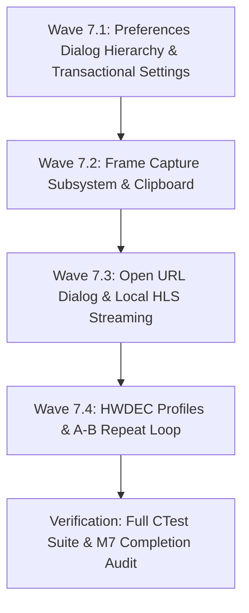

# Milestone M7 Implementation Plan: Advanced Features & Preferences Hierarchy (Revised)

> **Date:** 2026-11-11  
> **Status:** REVISED & READY FOR FINAL REVIEW  
> **Target:** Milestone M7 — Advanced Features & Preferences Dialog Hierarchy  
> **Frameworks:** GSD v1.6.0 & REA v6.8.0  
> **Reference Installation:** Daum PotPlayer 64-bit (`C:\Program Files\DAUM\PotPlayer`)

---

## 1. GSD Execution Phases vs. Project Milestones

In the JonakiPlayer engineering discipline:
- **Product Milestones (M0–M10):** High-level functional deliverables and architectural boundaries across the product roadmap.
- **GSD Phases (Phase 0–Phase 10):** Execution units with strict lifecycle gating (**DISCUSS → RESEARCH → PLAN → EXECUTE → VERIFY**), atomicity locks, and state synchronization.
- **Phase 7 Structure:** Milestone M7 executes inside GSD Phase 7 across four sequential waves (**Wave 7.1 through Wave 7.4**). Every wave consists of atomic, verifiable tasks producing conventional commits (`feat:`, `test:`, `fix:`, `docs:`). Implementation begins only upon user confirmation of this revised technical specification.

---

## 2. Preferences Hierarchy & Dialog Resource Disambiguation

### 2.1 Empirical Dialog Resource Audit (REV-018)
A comprehensive audit of `Language/English.ini` (5,626 lines) and the `RT_DIALOG` resource catalog in `PotPlayer64.dll` resolved the dialog mapping topology and corrected previously conflated dialog numbers:

| Category | Page / Node | Dialog ID | Reference PotPlayer Title / Controls | Empirical Resolution |
|---|---|---|---|---|
| **Shell** | Preferences Container | **Dialog 324** | `3035=&Reset`, `3042=&Export Settings...`, `3043=&Apply` | Master dialog shell hosting tree, stack, and actions |
| **General** | General Settings | **Dialog 354** | `3073=Snap to edge/window`, `3072=Show tooltips`, `3083=Store settings into .ini file` | Window snapping, tooltip display, INI toggle, focus |
| **General** | Startup | **Dialog 354/355** | `3116=Automatically run at startup`, `3123=Default window size` | Startup window geometry, remember position |
| **General** | OSD | **Dialog 375** | `3044=Filename`, `3049=Subtitle name`, `3050=Playback time`, `3053=Codec info` | On-Screen Display format, duration, font |
| **General** | Logo | **Dialog 378** | `3191=Logo Settings`, `3192=Logo (starting)`, `3193=Logo (off)` | Playback idle/loading logo display |
| **General** | Mouse | **Dialog 366** | `3381=Mouse Settings`, `3034=Left Button single click`, `3035=Mouse drag` | Click actions, double click, wheel mapping |
| **General** | Keyboard / Hotkeys | **Dialog 367** | `3021=Add...`, `3027=Edit...`, `3034=Turn on global media control keys` | Keyboard shortcut assignments and global hotkeys |
| **General** | Skin | **Dialog 376** | `3381=Skin Settings`, `3024=Open Skin Folder`, `3076=System dark mode` | Skin selection, dark mode, skinned context menus |
| **Playback** | Playback Settings | **Dialog 358** | `3061=Remember video playback positions`, `3083=Prevent screen saver` | Playback history, repeat modes, screensaver inhibit |
| **Playback** | Time Jump | **Dialog 364** | `3034=Jump to keyframe`, `3021=Default` (short/medium/long jump intervals) | Jump step sizes (default 5s, 30s, 60s) |
| **Playback** | Repeat & Resume | **Dialog 358/377** | `3083=Return to previous preset`, `3040=Copy preset values` | Resume thresholds, auto-repeat loop conditions |
| **Video** | Video Settings | **Dialog 366** | Aspect ratio presets (Default, 16:9, 4:3, 16:10, 1:1), deinterlace mode | Aspect ratio override, YADIF/hardware deinterlace |
| **Video** | Video Renderer & HWDEC | **Dialog 355/360** | `3040=Enable VMR Mixing Mode`, `3052=Color range`, `3110=Built-in DXVA Settings` | Direct3D11 / OpenGL render surface, HWDEC profile |
| **Video** | Color & Level Control | **Dialog 371** | `3381=Input:`, `3293=Level control`, `3294=Offset control`, `3061=Full range (Y: 0~255)` | Brightness, contrast, saturation, full/limited range |
| **Video** | Resizing & Cropping | **Dialog 369/374** | `3285=Video Resizing`, `3293=Video Extending/Cropping` | Aspect scaling, video padding, crop borders |
| **Audio** | Audio Output & Speakers | **Dialog 356** | `3381=Speakers:`, `3057=Enable`, `3061=Pass-through`, `3094=Expand stereo` | Output device selection, speaker channels (stereo/5.1) |
| **Audio** | Volume Normalizer | **dynaudnorm** | Peak target, max amplification, frame length | Real-time dynamic audio normalizer (`Shift+N`) |
| **Audio** | 10-Band Equalizer | **Dialog 363** | `3021=Preset`, `3066=Enable`, `3072=SuperEQ`, `3024=0 dB` (31Hz–16kHz) | 10-band sliders (-12dB to +12dB), pre-amp, presets |
| **Audio** | Audio Delay & Codec | **Dialog 361** | `3110=Built-in Audio Codec/Pass-through Settings` | Audio sync offset (+/-0.05s steps), codec routing |
| **Subtitles** | Subtitle Language & Priority| **Dialog 368** | `3034=Prioritize specified folders`, Language matching | External subtitle directory search, language priority |
| **Subtitles** | Font & Styling | **Dialog 353** | `3040=Show subtitles`, `3041=Absolute size`, `3043=Font face`, `3044=Font color` | ASS font family, point size, outline, shadow, colors |
| **Subtitles** | Sync & Placement | **Dialog 374** | Subtitle vertical margin, delay stepping (+/-0.5s) | Screen placement, horizontal/vertical margins, sync |
| **Filter Control**| Source / Splitter | **Dialog 325/350** | `3024=Source/Splitter`, `3110=Built-in Source/Splitter Settings` | Demuxer selection, network buffer cache size |
| **Filter Control**| Video Decoder Profiles | **Dialog 360** | `3110=Built-in Video Codec/DXVA Settings`, `3311=Video Decoder` | libmpv decoder priority, D3D11VA/DXVA2 hardware profiles |
| **Filter Control**| Audio Decoder Profiles | **Dialog 361** | `3110=Built-in Audio Codec/Pass-through Settings`, `3311=Audio Decoder` | FFmpeg audio decoder, S/PDIF pass-through |

*(Note: The duplicate Dialog 371 mapping in the preliminary draft is resolved. Video Color/Level control is Dialog 371; Audio Output & Speakers is Dialog 356; 10-Band Equalizer is Dialog 363).*

### 2.2 Complete Two-Level Navigation Hierarchy
The Preferences dialog implements the full two-level hierarchy in `QTreeWidget`:
```
Preferences (F5) [Baseline: 751x564 at 96 DPI]
├── General
│   ├── General Settings
│   ├── Startup
│   ├── OSD
│   ├── Logo
│   ├── Mouse
│   ├── Keyboard / Hotkeys
│   └── Skin / Theme
├── Playback
│   ├── Playback Settings
│   ├── Time Jump
│   └── Repeat & Resume
├── Video
│   ├── Video Settings
│   ├── Video Renderer & HWDEC
│   ├── Color & Level Control
│   └── Resizing & Cropping
├── Audio
│   ├── Audio Output & Speakers
│   ├── Volume Normalizer
│   ├── 10-Band Equalizer
│   └── Audio Delay & Codec
├── Subtitles
│   ├── Subtitle Language & Priority
│   ├── Font & Styling
│   └── Sync & Placement
└── Filter Control
    ├── Source / Splitter
    ├── Video Decoder Profiles
    └── Audio Decoder Profiles
```

### 2.3 Window Sizing & High-DPI Adaptation
- **Reference Geometry:** `751 × 564 pixels` measured on PotPlayer at standard 96 DPI (REV-008).
- **High-DPI Behavior:** In Qt 6, `PreferencesDialog` uses logical coordinates with automatic DPI scaling. Layout margins and size constraints are computed dynamically via `QFontMetrics` and `devicePixelRatio()` so that rendering scales crisp and unclipped at 125%, 150%, and 200% display scaling on Windows and Wayland/X11.

### 2.4 Transactional Settings Architecture
To guarantee robust transactional semantics:
1. **Staged Configuration Buffer:** When `PreferencesDialog` opens, it instantiates an isolated `SettingsTransaction` populated from `SettingsManager::instance()`.
2. **Page Architecture:** All leaf pages inherit from an abstract `PreferencesPageBase`:
   - `virtual void loadFrom(const SettingsTransaction& tx) = 0;`
   - `virtual void saveTo(SettingsTransaction& tx) const = 0;`
   - `virtual void resetToDefaults(SettingsTransaction& tx) = 0;`
   - `virtual bool isDirty() const = 0;`
   - `signals: void pageModified();`
3. **Button Semantics:**
   - **Apply:** Validates all pages, writes staged changes from `SettingsTransaction` to `SettingsManager`, flushes to `jonaki_settings.ini` via `saveToFile()`, emits `settingsApplied` signal to live engine components (`MpvPlaybackEngine`, `MainWindow`), and disables `Apply` until subsequent edits.
   - **OK:** Executes `Apply` logic, then closes the dialog (`accept()`).
   - **Cancel:** Discards all uncommitted changes in `SettingsTransaction`, leaves `SettingsManager` in its last applied state, and closes dialog (`reject()`).
   - **Reset:** Reverts controls on the currently active page (or prompts for "Reset All Pages") to defaults within `SettingsTransaction`, marking the buffer dirty and enabling `Apply`.
   - **Export Settings...:** Opens `QFileDialog::getSaveFileName`, serializing current staged settings to a custom `.ini` file without forcing an immediate commit to the application's active configuration.

---

## 3. Frame Capture Architecture

### 3.1 Strict Separation of Concerns (Qt-Independent Core)
To maintain architectural purity, `IPlaybackEngine` remains 100% free of Qt headers (`QImage`, `QPixmap`, `QWidget`). All image manipulation and clipboard interactions reside solely in the application/UI layer (`MainWindow` / `FrameCaptureHelper`).

### 3.2 Core Playback Engine Interface Extension
```cpp
// src/playback/IPlaybackEngine.h (Strictly C++20 / STL)
enum class CaptureMode {
    Video,      // Decoded video stream frame at native source resolution (no subtitles, no OSD)
    Subtitles,  // Decoded video frame with subtitle overlays (no OSD)
    Window      // Rendered mpv viewport output including OSD, subtitles & color adjustments
};

class IPlaybackEngine {
    // ... existing interface ...
    virtual bool captureFrame(const std::string& outputPath, CaptureMode mode = CaptureMode::Subtitles) = 0;
};
```

### 3.3 mpv Screenshot Command Mapping
Direct inspection of mpv 2.6.0 commands (`mpv --input-cmdlist`):
- `screenshot-to-file <filename> <flags>`:
  - `flags = "video"`: Executes `screenshot-to-file <path> video`. Captures decoded video without subtitles or OSD at raw media dimensions.
  - `flags = "subtitles"`: Executes `screenshot-to-file <path> subtitles`. Captures decoded video with subtitles rendered at source dimensions.
  - `flags = "window"`: Executes `screenshot-to-file <path> window`. Captures the mpv OpenGL surface viewport at current display dimensions. *(Documented boundary: this captures the mpv render viewport, NOT the Qt titlebar, control bar, or desktop window).*
- `screenshot-raw [flags]`: Can be queried asynchronously if direct pixel buffer access is required in future waves without disk I/O.

### 3.4 Application & UI Layer Implementation
- **Capture Folder:** Configurable via `SettingsManager` (defaults to user `Pictures/JonakiPlayer`).
- **Deterministic Filenames & Collision Invariant:**
  - Pattern: `Jonaki_YYYYMMDD_HHMMSS_mmm.png`
  - Invariant: Before writing, checks `std::filesystem::exists(targetPath)`. If a collision occurs (e.g., rapid bursts), a monotonic counter is appended (`Jonaki_YYYYMMDD_HHMMSS_mmm_01.png`), guaranteeing that prior snapshots are never overwritten.
- **Clipboard Management (`Ctrl+C` / `Ctrl+Alt+C`):**
  - Managed strictly within Qt UI: UI triggers capture to a secure temporary file, loads `QImage(tempPath)`, places it on `QGuiApplication::clipboard()`, and immediately deletes the temporary file.
- **Asynchronous Result & OSD Notification:**
  - Upon successful capture, engine issues non-blocking OSD: `Saved: <filename> (<width>x<height>)`.
  - On failure, issues OSD warning: `Frame capture failed`.

---

## 4. Open URL & Network Streaming Architecture

### 4.1 URL Validation & Protocols
- **Validation Engine:** `UrlValidator::validate(url)` verifies:
  - Scheme must be `http://` or `https://` (case-insensitive).
  - Host component must be non-empty and well-formed.
  - Port (if specified) must be in range `1..65535`.
- **Bundled Protocol Verification:**
  - MSYS2 UCRT64 FFmpeg 9.0 build verified: includes input protocols `http`, `https`, `tls`, `tcp`, `crypto`, and demuxer `D hls` (Apple HTTP Live Streaming).

### 4.2 Local Offline HLS & HTTP Test Harness
To avoid flaky public internet dependencies during CI and automated testing:
- **Test Server:** A lightweight embedded Python HTTP server (`http.server` running on `127.0.0.1:<ephemeral-port>`).
- **Synthetic Assets:** Server serves a generated `test_stream.m3u8` and corresponding `.ts` slices generated from `tests/test_data/test_video_aac.mp4`.
- **Failure Simulation:** Server can simulate HTTP 404, HTTP 500, socket drops, and latency timeouts to empirically verify engine error callbacks (`PlaybackError::NetworkError`).

### 4.3 Open URL Dialog (`Ctrl+U`) Specification
- **Visual Structure:** Matches PotPlayer Dialog 310 (`3381=Open URL`):
  - Label: `3285=Input the URL of the stream or file to be played.`
  - Combo Box: Editable line entry with persistent history dropdown.
  - Checkbox: `3034=Auto paste URLs from clipboard` (wired to `SettingsManager`).
  - Action Buttons: `Open`, `Cancel`, `Clear History`.
- **Auto-Paste Logic:** If enabled in settings and system clipboard contains a valid `http://` or `https://` URL on dialog show, the URL is automatically populated into the input field.

---

## 5. Hardware-Decoding Profile Architecture

### 5.1 Bundled libmpv 2.6.0 Hardware Decoding Capabilities (REV-019)
Empirical command inspection (`mpv --hwdec=help`) verified available decoders:
- **Windows Targets:** `d3d11va`, `d3d11va-copy`, `dxva2`, `dxva2-copy`, `d3d12va`, `d3d12va-copy`, `auto-safe`, `no`.
- **Linux Targets:** `vaapi`, `vaapi-copy`, `nvdec`, `nvdec-copy`, `auto-safe`, `no`.
- **UI Enumeration Filtering:** Only decoders supported by the active host operating system and compiled into the runtime binary will be displayed in the Preferences UI. Unsupported profiles are hidden or marked disabled.

### 5.2 Dynamic Decoder Mutation & Introspection
- **Requested vs. Active State:**
  - `getHwdecRequested()`: Returns the configured profile setting (`SettingsManager` / `mpv_set_property_string(mpv, "hwdec", profile)`).
  - `getHwdecActive()`: Returns the live runtime decoder actively producing frames, queried directly from mpv observed property `hwdec-current`.
  - `getHwdecInterop()`: Introspects the GPU interop backend (`dxva2-dxva2g`, `d3d11va`, etc.).
- **Runtime Transition Policy:**
  1. Engine dynamically sets `mpv_set_property_string(m_mpv, "hwdec", requestedProfile.c_str())`.
  2. Engine observes `hwdec-current`.
  3. **No Unconditional Reload:** If the decoder hot-switches on the fly (supported across copy-back modes and software fallback), playback continues uninterrupted.
  4. **Conditional Seamless Reload:** Only if `hwdec-current` fails to transition or reports a decoder error:
     - Record `pos = getCurrentTime()`, `state = getState()`.
     - Issue `loadfile <url> replace start=<pos>`.
     - If previously paused, restore paused state upon decode start.
     - Playback position and stream continuity are strictly preserved.

---

## 6. A-B Repeat Loop Subsystem

### 6.1 mpv Native Loop Engine Integration
Rather than implementing an external polling timer loop with imprecise seeks, JonakiPlayer binds directly to mpv's native, sample-accurate loop properties:
- `ab-loop-a`: Timestamp (seconds) of loop start.
- `ab-loop-b`: Timestamp (seconds) of loop end.
- When both are set, mpv automatically loops audio/video packets from B back to A at the demuxer/decoder level.

### 6.2 Shortcut & Boundary State Machine
| Action | Hotkey | Engine Operation | OSD Notification | Seekbar Marker |
|---|---|---|---|---|
| **Set Point A** | `[` | Query `currentTime`, set `ab-loop-a = pos` | `A-B Repeat: Point A [00:15]` | Paint cyan marker at Point A |
| **Set Point B** | `]` | Query `currentTime`, validate `pos > pointA + 0.2s`, set `ab-loop-b = pos` | `A-B Repeat: Point B [00:45]` | Paint orange marker at Point B |
| **Toggle / Clear** | `\` | Set `ab-loop-a = "no"`, `ab-loop-b = "no"` | `A-B Repeat: Off` | Clear markers from seekbar |
| **Reset Point A** | `Shift+[` | Set `ab-loop-a = "no"` | `A-B Repeat: Point A Cleared` | Clear marker A |
| **Reset Point B** | `Shift+]` | Set `ab-loop-b = "no"` | `A-B Repeat: Point B Cleared` | Clear marker B |

- **Boundary Validation:** If Point B is pressed when `currentTime <= pointA`, engine rejects with OSD: `A-B Repeat: Point B must be after Point A`. Incomplete loops (only Point A set) display marker A but allow linear playback until Point B is marked.
- **Seekbar Rendering:** `BottomControlBar::paintEvent()` calculates horizontal fraction `x = (pointA / duration) * trackWidth` and draws distinct PotPlayer-style marker ticks.

---

## 7. Wave Breakdown & Detailed Implementation Tasks



### Wave 7.1: Preferences Dialog & Transactional Settings
- **Tasks:**
  1. Implement `SettingsTransaction` staging class wrapping `SettingsManager`.
  2. Implement `PreferencesPageBase` abstract class with dirty tracking and signals.
  3. Implement all two-level leaf pages grouped into modular classes:
     - `GeneralPreferencesPage` (General Settings, Startup, OSD, Logo, Mouse, Keyboard, Skin).
     - `PlaybackPreferencesPage` (Playback Settings, Time Jump, Repeat/Resume).
     - `VideoPreferencesPage` (Video Settings, Renderer & HWDEC, Color/Level Control, Resizing).
     - `AudioPreferencesPage` (Audio Output/Speakers, Volume Normalizer, 10-Band EQ, Audio Delay).
     - `SubtitlePreferencesPage` (Language & Priority, Font & Styling, Sync & Placement).
     - `FilterControlPreferencesPage` (Source/Splitter, Video Decoder, Audio Decoder).
  4. Implement `PreferencesDialog` (`751 × 564` baseline at 96 DPI, High-DPI layout) with left `QTreeWidget`, stacked widget, and action buttons (`Reset`, `Export`, `Apply`, `OK`, `Cancel`).
  5. Bind `F5` hotkey in `MainWindow` and add menu action to `ContextMenuBuilder`.
- **Testing:** `tests/unit/test_preferences_dialog.cpp`:
  - Verify tree selection maps 100% to corresponding stacked page.
  - Verify `Apply` flushes staged edits to `SettingsManager`.
  - Verify `Cancel` drops staged edits without touching active settings.
  - Verify `Reset` reverts active page to factory defaults.
  - Verify `Export Settings` produces a valid `.ini` file matching schema.
- **Acceptance Criteria:**
  - Dialog launches on `F5` or context menu at scaled 751×564 geometry.
  - All 6 categories and leaf pages navigate cleanly.
  - Transactional persistence verified: `Cancel` discards edits, `Apply`/`OK` commits cleanly.

---

### Wave 7.2: Frame Capture Subsystem & Snapshot Management
- **Tasks:**
  1. Extend `IPlaybackEngine.h` with `captureFrame(const std::string& path, CaptureMode mode)`.
  2. Implement `captureFrame` in `MpvPlaybackEngine.cpp` wrapping `screenshot-to-file` with `"video"`, `"subtitles"`, and `"window"` modes.
  3. Implement `FrameCaptureHelper` in UI layer handling output directory configuration, timestamping (`Jonaki_YYYYMMDD_HHMMSS_mmm.png`), overwrite prevention, and temporary file clipboard copying (`Ctrl+C` / `Ctrl+Alt+C`).
  4. Bind `Ctrl+E`, `Ctrl+Alt+E`, `Ctrl+C`, `Ctrl+Alt+C` in `MainWindow::keyPressEvent()`.
  5. Add "Video Capture" submenu with capture options to `ContextMenuBuilder`.
  6. Update `MockPlaybackEngine.h` to satisfy new pure virtual methods.
- **Testing:** `tests/integration/test_frame_capture.cpp`:
  - Verify source capture (`CaptureMode::Video`) outputs valid PNG matching video resolution.
  - Verify subtitle capture (`CaptureMode::Subtitles`) includes rendered text pixels.
  - Verify sequential rapid captures generate distinct filenames without overwriting.
  - Verify clipboard image validity (`QImage` non-null and format valid).
- **Acceptance Criteria:**
  - `Ctrl+E` creates a raw source PNG; `Ctrl+Alt+E` creates a subtitle-overlay PNG.
  - `Ctrl+C` copies image to system clipboard.
  - Zero overwrites during rapid continuous capture.

---

### Wave 7.3: Open URL & Network Streaming
- **Tasks:**
  1. Implement `UrlValidator` verifying `http://` / `https://` schemes, hostnames, and ports.
  2. Implement `OpenUrlDialog` (`src/ui/OpenUrlDialog.h/.cpp`) matching PotPlayer Dialog 310.
  3. Wire URL history storage and "Auto paste URLs from clipboard" checkbox to `SettingsManager`.
  4. Connect `OpenUrlDialog` acceptance to `IPlaybackEngine::loadMedia()`.
  5. Implement local Python HTTP/HLS test harness serving synthetic multi-segment HLS streams.
  6. Bind `Ctrl+U` in `MainWindow` and add menu action in `ContextMenuBuilder`.
- **Testing:** `tests/integration/test_network_streaming.cpp`:
  - Test URL validation on valid and malformed URLs.
  - Test playback of local HTTP stream (`http://127.0.0.1:<port>/stream.mp4`).
  - Test playback of local HLS stream (`http://127.0.0.1:<port>/test_hls.m3u8`).
  - Test error handling on HTTP 404 / connection refusal (verifies non-blocking OSD).
- **Acceptance Criteria:**
  - `Ctrl+U` opens URL dialog with optional auto-paste from clipboard.
  - Valid HTTP/HLS streams load and play seamlessly.
  - Network failures report clean `PlaybackError::NetworkError` without crashing.

---

### Wave 7.4: Hardware-Decoding Profiles & A-B Repeat
- **Tasks:**
  1. Add `setHwdecProfile(profile)` and `getHwdecRequested()` / `getHwdecActive()` to `IPlaybackEngine` and `MpvPlaybackEngine`.
  2. Implement runtime `hwdec` property mutation and conditional seamless reload in `MpvPlaybackEngine`.
  3. Add A-B repeat methods (`setABRepeatPointA()`, `setABRepeatPointB()`, `clearABRepeat()`, `getABRepeatPointA()`, `getABRepeatPointB()`, `isABRepeatActive()`) to `IPlaybackEngine` and `MpvPlaybackEngine` binding to mpv `ab-loop-a` / `ab-loop-b`.
  4. Bind `[`, `]`, `\`, `Shift+[`, `Shift+]` in `MainWindow`.
  5. Implement Point A and Point B marker rendering on timeline rail in `BottomControlBar`.
  6. Update `MockPlaybackEngine.h`.
- **Testing:** `tests/unit/test_hwdec_ab_repeat.cpp`:
  - Verify HWDEC profile switching, property setting, and settings persistence.
  - Verify A-B loop boundary validation (Point B > Point A rejection).
  - Verify looping mechanics: playback hitting Point B jumps back to Point A.
  - Verify timeline marker coordinate calculations across varying window widths.
- **Acceptance Criteria:**
  - Setting A and B loops playback continuously with visible seekbar markers.
  - `\` clears the loop and markers immediately.
  - HWDEC profile switching updates `hwdec` and preserves playback position and play/pause state.

---

## 8. Expanded M7 Test Suite & Regression Matrix

| Test Executable | Target Source | Coverage Areas | Empirical Verification Invariant |
|---|---|---|---|
| **`SettingsTest`** | `test_settings.cpp` | Base settings manager | INI round-trip, thread-safety, type conversions |
| **`PlaybackEngineMockTest`** | `test_playback_mock.cpp` | Pure mock engine | Lifecycle, media loading, speed, volume, state |
| **`MpvPlaybackIntegrationTest`**| `test_mpv_integration.cpp` | Real libmpv core | Time progression, seeking, pause, track demux |
| **`SkinParserTest`** | `test_skin_parser.cpp` | Skin XML & coordinates | XML node hierarchy, layout constraints |
| **`PlaylistTest`** | `test_playlist.cpp` | DPL & SQLite resume | DPL parsing/serializing, database schema |
| **`SubtitleTest`** | `test_subtitles.cpp` | Subtitle manager & OSD | SRT/ASS demuxing, delay offset, Bengali conjuncts |
| **`AudioVideoFilterTest`** | `test_audio_video_filters.cpp`| EQ, dynaudnorm, deinterlace| Filter graph coexistence, aspect ratio scaling |
| **`PreferencesDialogTest`** *(New)* | `test_preferences_dialog.cpp` | Preferences tree & transaction | 2-level navigation, Apply/Cancel/OK/Reset semantics |
| **`FrameCaptureTest`** *(New)* | `test_frame_capture.cpp` | Screenshot & clipboard | Video/Subtitle modes, no overwrite, PNG validity |
| **`NetworkStreamingTest`** *(New)*| `test_network_streaming.cpp` | HTTP & local HLS | Local HLS playback, URL validation, 404 error OSD |
| **`HwdecAbRepeatTest`** *(New)* | `test_hwdec_ab_repeat.cpp` | HWDEC & A-B Repeat loop | Profile switching, A-B loop seek, marker painting |

**Total Target:** 11 passing CTest targets with 100% success rate and zero regressions.

---

## 9. Immediate Next Actions

1. Present this revised technical implementation plan to the user for final confirmation.
2. Upon approval, begin execution of **Wave 7.1** (Preferences Dialog & Transactional Settings Architecture).
3. Commit atomically after each verified wave with clean conventional commits.
4. Conclude M7 with visual screenshot evidence and the milestone completion report.
