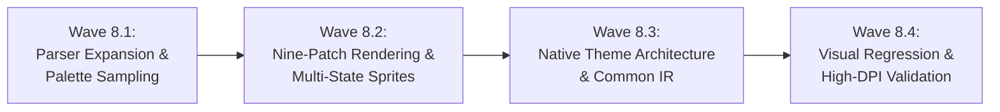

# Milestone M8 Implementation Plan: Skin Engine Fidelity & Complete Theming

> **Milestone:** M8 — Skin Engine Fidelity & Complete Theming  
> **Status:** APPROVED IMPLEMENTATION PLAN (Pre-Implementation Lock Active)  
> **Date:** 2026-11-12  
> **Architecture Reference:** [`docs/architecture/m8_skin_and_theme_architecture.md`](file:///f:/Projects/JonakiPlayer/docs/architecture/m8_skin_and_theme_architecture.md)  
> **Directive Inventory Reference:** [`docs/reverse-engineering/skin_directive_inventory.json`](file:///f:/Projects/JonakiPlayer/docs/reverse-engineering/skin_directive_inventory.json)  
> **Planning Rule:** Implementation for Wave 8.1 will NOT begin until this plan and architecture are formally accepted.  

---

## 1. Milestone Objectives

1. Achieve complete visual, layout, and behavioral fidelity with PotPlayer's default skin (`Default.dsf`, `WindowFrame.dsf`) using clean-room engineering.
2. Establish a **Common Intermediate Representation (IR)** (`SkinThemeModel`) unifying legacy PotPlayer `.dsf`/XML and modern native JonakiPlayer `.json`/SVG themes.
3. Consolidate UI painting into a single, high-performance Qt `SkinRenderer` that supports 3-patch, 9-patch, 4-frame button state strides, and dynamic palette sampling.
4. Provide ironclad security against malicious custom skins (Zip Slip traversal, decompression bombs, XXE attacks, and corrupted theme crashes).
5. Establish an automated dual-tier visual regression harness validating logical geometry and physical rendering across 100%, 125%, and 150% DPI.

---

## 2. Wave Breakdown & Task Decomposition

---

### Wave 8.1: Parser Expansion & Palette Sampling
**Goal:** Expand `SkinParser` into an XXE-safe, zip-safe compiler that extracts all reference directives, parses responsive rules, and resolves dynamic palette colors from sprite pixels.

- **Task 8.1.1 — Secure DSF Archive Extractor (`DsfArchiveExtractor`)**
  - Clean-room ZIP unpacker for `.dsf` skins.
  - Path traversal defense: Validates canonical paths to prevent Zip Slip (`../`).
  - Decompression bomb guard: Enforces 50MB total extracted size limit, 20MB per-file limit, 150 file limit, and 100:1 ratio ceiling.
  - Rejection of non-conforming or corrupted archives with descriptive error return.

- **Task 8.1.2 — XXE-Safe XML Parser & Directive Expansion**
  - Migrate `SkinParser` to strictly configured `QXmlStreamReader` with external entity resolution disabled (`setEntityResolver(nullptr)`).
  - Add parser support for:
    - `<ImageReplace Image='...' AlphaMode='...'>` scoped texture overriding.
    - `<Image>` static graphic badge and icon slicing.
    - `<SubImage>` composite overlays.
    - `Alignment='5'` mapped to `Qt::AlignCenter`.
    - `DownFlag='1'` mapped to checkable button toggle states.

- **Task 8.1.3 — Dynamic Bitmap Palette Sampler (`PaletteSampler`)**
  - Implement `ColorX` and `ColorY` sampling from the active atlas (`Main.png`).
  - Resolve text colors at load time:
    - `(1052, 74)` -> `#FFFFFF` (Primary Text / Elapsed Time).
    - `(864, 127)` -> `#FF3217` (Orange Accent / Live indicator).
    - `(875, 528)` -> `#777777` (Secondary Text / Total Time).
  - Cache sampled colors in `PaletteDefinition`.

- **Task 8.1.4 — Responsive Visibility Directive Engine**
  - Parse and store `VisParentMinWidth` (thresholds: 240, 300, 450, 550, 630, 670, 690, 700, 740 px).
  - Parse and store `VisMinLeft` (thresholds: 320, 350, 380, 410 px).
  - Integrate dynamic visibility evaluation into container layout pass.

---

### Wave 8.2: Nine-Patch Rendering & Multi-State Sprites
**Goal:** Implement full 4-frame button state extraction, 3-patch and 9-patch border slicing, custom scrollbars, and on-screen animation widgets.

- **Task 8.2.1 — 4-Frame Horizontal Stride Button Extractor**
  - Automatically derive 4 interaction frames from `ImageLeft`, `ImageTop`, `ImageWidth`, `ImageHeight`:
    - Normal: `x`
    - Hover: `x + w`
    - Pressed: `x + 2w`
    - Disabled: `x + 3w`
  - Support checkable buttons (`DownFlag='1'`): Pressed frame used when checked.

- **Task 8.2.2 — 3-Patch Horizontal & Vertical Slicing**
  - Slicing for titlebars, seekbars, volume faders, and control bar panels.
  - Preserves fixed left/right or top/bottom caps (`LeftMargin`, `RightMargin`) while stretching/tiling the central slice.

- **Task 8.2.3 — 9-Patch Window Chrome & Popup Slicing**
  - Slices window frames (`WindowType0/1/2`, `Window.png`): 4 corners (unscaled), 4 borders (stretched/tiled along 1 axis), and 1 center (fill).
  - Applied to frameless main window and context menus.

- **Task 8.2.4 — ScrollBar Composite Component Rendering**
  - Reconstruct custom scrollbars from `ScrollBar.bmp` and `ScrollBarPL.bmp`:
    - `<ArrowUp>`, `<ArrowDown>`, `<ArrowLeft>`, `<ArrowRight>` 4-frame buttons.
    - `<ThumbUp>`, `<ThumbMiddle>`, `<ThumbDown>` 3-patch draggable thumbs.

- **Task 8.2.5 — PlayPauseWidget On-Screen Animation Overlay**
  - Implement centered touch/click overlay in `VideoOpenGLWidget`.
  - Display 131×131 play/pause badge from `TouchMain.png`.
  - Non-blocking Qt animation timeline: 150 ms linear fade-in, 350 ms hold (opacity 0.75), 250 ms quadratic fade-out.

---

### Wave 8.3: Native Theme Architecture & Common IR
**Goal:** Finalize the platform-neutral `SkinThemeModel` IR, implement the `NativeThemeLoader` for JSON/SVG themes, and unify rendering under one `SkinRenderer`.

- **Task 8.3.1 — Intermediate Representation (`SkinThemeModel`) Definition**
  - Formalize data structures: `ControlDefinition`, `SpriteSlice`, `StateFrameMap`, `PaletteDefinition`, `TypographyDefinition`, `VisibilityRule`, `WindowChromeSpec`.
  - Decouple IR completely from file formats.

- **Task 8.3.2 — `PotPlayerSkinCompiler`**
  - Compiles parsed PotPlayer XML AST into `SkinThemeModel`.
  - Normalizes button strides, resolves palette coordinates, binds command IDs.

- **Task 8.3.3 — `NativeThemeLoader`**
  - Ingests native JonakiPlayer themes (`theme.json` + SVGs).
  - Validates JSON schema (control names, docking, color tokens, font sizes).
  - Populates identical `SkinThemeModel`.

- **Task 8.3.4 — Unified `SkinRenderer`**
  - Refactor `SkinRenderer` to consume `std::shared_ptr<const SkinThemeModel>`.
  - Paints widgets using 3-patch/9-patch algorithms, multi-state frames, and DPI-aware scaling.
  - Zero duplicate rendering code.

- **Task 8.3.5 — Malformed Theme Containment & Default Fallback**
  - Invariant: A malformed, incomplete, or corrupted theme must never crash JonakiPlayer.
  - Automatic error catch, memory cleanup, and fallback to built-in procedural Default Theme.
  - User notification via OSD warning.

---

### Wave 8.4: Visual Regression & High-DPI Validation
**Goal:** Deploy a dual-tier visual regression testing harness validating geometry and appearance across resolutions and DPI factors.

- **Task 8.4.1 — High-DPI Scaling Engine (100%, 125%, 150%)**
  - Distinguish logical Qt coordinates (`rect()`) from physical screenshot pixels (`grab().size()`).
  - Normalize Device Pixel Ratio (DPR) across testing environments.

- **Task 8.4.2 — Multi-Resolution Geometry Verification Suite**
  - Deterministic assertions on widget bounds:
    - Baseline: 723 × 399 px
    - Intermediate: 800 × 450, 1024 × 576, 1366 × 768 px
    - Fullscreen (1920 × 1080) and Restored
    - TitleBar height (31 px), BottomControlBar height (62 px), Seekbar (22 px), Buttons (40 px), Min bounds (300 × 160 px).

- **Task 8.4.3 — Tolerant Component-Level Pixel Comparison**
  - Mask dynamic video viewports (OpenGL canvas) and live timecode text.
  - Compare static chrome components using Structural Similarity (SSIM > 0.95) and maximum RMS error (< 5%).

- **Task 8.4.4 — Comprehensive Parity Gap Audit & UI Polish**
  - Validate all 16 major UI functional areas against reference PotPlayer.
  - Refine margins, hover transitions, and tooltips.

- **Task 8.4.5 — Milestone M8 Parity Sign-Off & Verification Report**
  - Document all empirical evidence, screenshots, and test execution results.

---

## 3. Wave Acceptance Criteria

Unlike previous milestones that used fixed CTest target counts, acceptance in M8 is strictly governed by **behavioral proofs, test coverage, and verifiable empirical artifacts**:

### Wave 8.1 Acceptance Criteria
- [ ] **Zip Slip & Bomb Protection:** Unit tests prove rejection of `../` traversal paths, files > 20MB, archives > 50MB, and files > 150 count.
- [ ] **XXE Protection:** Unit tests prove XML containing `<!DOCTYPE>` or external entity declarations is parsed without entity expansion or network access.
- [ ] **Directive Coverage:** Parser successfully parses all tags in `skin_directive_inventory.json` (`<ImageReplace>`, `<Image>`, `<SubImage>`, `<Button>`, `<Static>`, `<Label>`, `<Slider>`, `<Layout>`).
- [ ] **Palette Sampling Proof:** Unit test asserts that sampling `(1052, 74)` yields `#FFFFFF`, `(864, 127)` yields `#FF3217`, and `(875, 528)` yields `#777777`.
- [ ] **Responsive Rule Proof:** Unit test verifies that a widget with `VisParentMinWidth=630` is hidden when container width is 629px and visible at 630px.

### Wave 8.2 Acceptance Criteria
- [ ] **4-Frame Stride Extraction:** Unit tests prove correct bounding rects for Normal, Hover, Pressed, and Disabled states across standard button sizes (41px, 23px, 14px).
- [ ] **3-Patch & 9-Patch Rendering:** Visual snapshot evidence demonstrating seamless horizontal stretching without distorted corner caps.
- [ ] **ScrollBar Component Verification:** Unit test confirms extraction and rendering of thumb top/middle/down slices and arrows from `ScrollBar.bmp`.
- [ ] **PlayPauseWidget Animation:** Integration test verifies widget creation, opacity progression (0 -> 0.75 -> 0), and destruction within 750 ms without blocking the main event loop.

### Wave 8.3 Acceptance Criteria
- [ ] **Common IR Validation:** Tests prove both `PotPlayerSkinCompiler` and `NativeThemeLoader` generate valid, compliant `SkinThemeModel` instances.
- [ ] **Single Renderer Invariant:** All UI rendering is executed solely through `SkinRenderer`; no secondary renderer classes exist.
- [ ] **Malformed Theme Fallback:** Test loads a truncated/corrupted JSON and a corrupt DSF; engine logs error, displays OSD message, and cleanly activates default theme with zero memory leaks or crashes.
- [ ] **Clean-Room Packaging Audit:** Automated build check verifies `resources/reference/` is 100% excluded from installation and distribution packages.

### Wave 8.4 Acceptance Criteria
- [ ] **Multi-DPI Geometry Parity:** Automated test verifies logical layout geometry remains identical across DPR 1.0 (96 DPI), DPR 1.25 (120 DPI), and DPR 1.5 (144 DPI).
- [ ] **Multi-Resolution Invariance:** Window correctly resizes through 723×399, 800×450, 1024×576, 1366×768, and Fullscreen, maintaining titlebar (31px) and control bar (62px) invariants.
- [ ] **Visual Component SSIM > 0.95:** Chrome components achieve structural similarity index > 0.95 against reference baseline.
- [ ] **Zero Regressions:** All prior milestone test suites pass cleanly.
