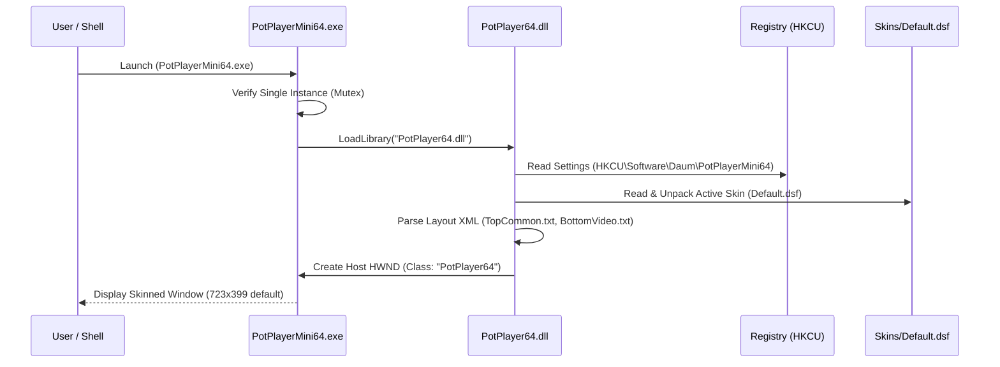

# PotPlayer Application & Binary Architecture Analysis

> **Milestone:** M1 — PotPlayer Reconnaissance & Evidence Mapping  
> **Status:** Completed & Empirically Verified  
> **Target:** Daum/Kakao PotPlayer 64-bit v250515  
> **Installation Path:** `C:\Program Files\DAUM\PotPlayer`  

---

## 1. Executable & Dynamic Link Library Architecture

Static binary inspection via `pefile` and REA analysis of the reference installation reveals a modular architecture:

```
┌────────────────────────────────────────────────────────┐
│                 PotPlayerMini64.exe                    │
│    (Thin launcher stub, ImageBase: 0x140000000)        │
│       Imports: KERNEL32, USER32, ole32, CRYPT32        │
└───────────────────────────┬────────────────────────────┘
                            │ Dynamic Load & Injection
                            ▼
┌────────────────────────────────────────────────────────┐
│                   PotPlayer64.dll                      │
│     (Main player core, ImageBase: 0x180000000)         │
│  43 exported functions, 184 RT_DIALOG native resources │
└───────┬───────────────────┬───────────────────┬────────┘
        │                   │                   │
        ▼                   ▼                   ▼
┌──────────────┐    ┌──────────────┐    ┌───────────────┐
│ ffcodec64.dll│    │ MediaDB64.dll│    │ ATextOut64.dll│
│(FFmpeg codecs│    │(Metadata/DB/ │    │ (SubStation   │
│ & demuxers)  │    │ Playlist)    │    │ Alpha/Text)   │
└──────────────┘    └──────────────┘    └───────────────┘
```

### 1.1 Binary Role Distribution [DIRECTLY-OBSERVED]
- **`PotPlayerMini64.exe` (253 KB):** Thin frontend bootstrap. Responsible for command line parsing, single-instance verification via named mutexes/events, and hosting the main window HWND.
- **`PotPlayer64.dll` (11.9 MB):** The core engine. Contains the entire skin layout interpreter, menu builders, preferences tree, D3D/GDI rendering pipelines, and event dispatchers.
- **`ffcodec64.dll` (39.1 MB):** An embedded custom build of FFmpeg (`libavcodec`, `libavformat`, `libswscale`, `libswresample`).
- **`MediaDB64.dll` (4.0 MB):** Manages SQLite/SDB database storage for playback history, bookmark persistence, and metadata indexers.
- **`ATextOut64.dll` (4.0 MB):** Advanced font rendering and subtitle rasterization engine (clean-room substitute: `libass` + FreeType/HarfBuzz).

### 1.2 Export Table Taxonomy of `PotPlayer64.dll` [DIRECTLY-OBSERVED]
The DLL exposes 43 explicit procedural APIs, including:
- Lifecycle: `CreatePotPlayerW`, `CreatePotPlayerExW`, `DestroyPotPlayer`, `UninitPotPlayer`.
- Window & UI Management: `ResizeWindow`, `ShowPotPlayerUI`, `SetUIOption`, `GetPotWindowLong`.
- Navigation & Control: `SendPotPlayerCmd`, `SetPotPlayerSeek`, `SetPotPlayerVolume`, `GetPotPlayerValue`.
- Configuration: `SetPotPlayIniFileW`, `SetPotPlayRegKeyW`, `GetPotPlayerStringValueW`.
- Media Loading: `AddPotPlayerUrlW`, `OpenPotPlayerUrlW`, `GetMediaFileDetectW`.

---

## 2. Process Lifecycle & Execution Flow



---

## 3. Command Line Interface (CLI) Specification [DIRECTLY-OBSERVED]

From `CmdLine64.txt`, PotPlayer supports the following CLI arguments:
- `content`: Path to file, folder, wildcard, or HTTP/HTTPS stream URL.
- `-`: Play streaming media from standard input (`stdin`).
- `/filedlg`: Open standard file selection dialog.
- `/urldlg`: Open streaming URL dialog.
- `/folderdlg`: Open directory selection dialog.
- `/cap`: Launch screen capture session.
- `/cam`: Open webcam/DirectShow capture device.
- `/dvd`: Play DVD root structure.
- `/add`: Append specified content to active playlist.
- `/insert`: Insert content below currently playing item.
- `/autoplay`: Resume last played media item.
- `/new`: Force a separate independent instance.
- `/seek=hh:mm:ss.ms`: Seek to exact timestamp immediately on playback start.
- `/sub="path"`: Explicitly load external subtitle stream.
- `/aud="path"`: Explicitly load external audio track.
- `config="preset"`: Load custom configuration profile.

---

## 4. Architectural Boundaries for Clean-Room Reimplementation

| PotPlayer Component | Proprietary Asset | Clean-Room Equivalent in JonakiPlayer | Evidence Status |
|---|---|---|---|
| Launcher & Host | `PotPlayerMini64.exe` | `JonakiApplication` (Qt 6 + `QApplication`) | [DIRECTLY-OBSERVED] |
| Skinned UI & Frame | `PotPlayer64.dll` | `MainWindow` + `SkinRenderer` (Qt C++20) | [DIRECTLY-OBSERVED] |
| Codec Framework | `ffcodec64.dll` | System `FFmpeg` / `libavcodec` | [DIRECTLY-OBSERVED] |
| Playback Engine | Core DirectShow filters | `libmpv` (C API, render context) | [DIRECTLY-OBSERVED] |
| Subtitle Engine | `ATextOut64.dll` | `libass` + Qt FontEngine | [DIRECTLY-OBSERVED] |
| Metadata & History | `MediaDB64.dll` | SQLite / JSON history store | [DIRECTLY-OBSERVED] |
